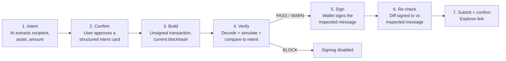
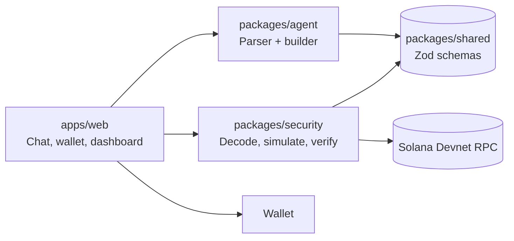

# SolGuard

**Trust nothing. Sign with confidence.**

SolGuard is an intent-aware, pre-sign transaction firewall for Solana. You describe a transfer in plain English, and before anything reaches your wallet, an independent security engine decodes the transaction, simulates it on Devnet and checks it against what you actually asked for. Mismatches are blocked before signing.

> We don't ask users to trust the AI. We verify its transactions before users trust it with their money.

Built for the Zettabyte team at the Dev3pack Hackathon (27-29 November 2026). Devnet only.

---

## Table of contents

- [The problem](#the-problem)
- [How it works](#how-it-works)
- [Trust model](#trust-model)
- [Features](#features)
- [Security rules](#security-rules)
- [Architecture and repo layout](#architecture-and-repo-layout)
- [Shared contracts](#shared-contracts)
- [Getting started](#getting-started)
- [Testing](#testing)
- [Demo scenarios](#demo-scenarios)
- [Team and branches](#team-and-branches)
- [Roadmap](#roadmap)
- [Limitations](#limitations)
- [Contributing](#contributing)
- [Security principles](#security-principles)
---

## The problem

Users routinely sign transactions they do not fully understand. A transaction that executes successfully is not necessarily one that does what the user intended. AI agents that build transactions on a user's behalf add a new attack surface: hallucination, prompt injection and malicious third-party transaction builders.

SolGuard closes that gap by comparing three independent sources of truth:

| Source | Question it answers |
|---|---|
| **User intent** | What did the user confirm they want to happen? |
| **Transaction instructions** | What is the transaction programmed to do? |
| **Simulated outcome** | What does the chain predict will happen? |

If the three do not agree, signing stays disabled.

## How it works



1. **Intent.** The user types a request. A structured LLM tool call extracts recipient, asset and amount.
2. **Confirm.** The user confirms a card rendered from validated structured fields only. LLM prose never populates it.
3. **Build.** Deterministic code builds the unsigned transaction with integer base units and a current blockhash.
4. **Verify.** The security engine decodes every instruction, simulates on Devnet and compares predicted effects to the confirmed intent.
5. **Sign.** Approval is bound to the exact inspected message. The wallet owner alone signs.
6. **Re-check.** After the wallet returns the signed transaction, it is re-decoded and diffed against the inspected message to catch wallet-side mutation.
7. **Submit.** Only after a matching PASS or WARN report is the transaction sent and confirmed.
## Trust model

| Zone | Responsibility | Trusted? |
|---|---|---|
| **AI** | Parses language, drafts intent, paraphrases findings | No, treated as untrusted input |
| **Deterministic engine** | Schema validation, building, decoding, simulation, policy checks | Yes |
| **Wallet owner** | Confirms structured intent, signs | Final authority |

A hallucinating or prompt-injected model can at worst produce a bad intent. The user sees that in a structured confirmation, and the verifier checks the transaction against the confirmed intent, never against the model's claims.

## Features

**MVP**
- Plain-English SOL transfers
- Structured intent confirmation card
- Instruction decoding with a program allowlist (fail closed)
- Live Devnet simulation with pre/post balance deltas
- Intent verification with BLOCK / WARN / PASS verdicts and evidence
- Wallet connection and signing (Phantom, Solflare via Wallet Standard)
- Post-wallet signed-transaction re-verification
- Security receipt with `messageHash` and Solana Explorer link
- External transaction analyzer: paste an unsigned transaction from any third-party dApp, state your intent, and get an independent analysis
**Next**
- SPL token transfers (`transferChecked`)
- Approve / SetAuthority / CloseAccount detection
- Token-2022 extension checks (freeze authority, permanent delegate, transfer fees, transfer hooks)
**Stretch**
- Client-side spending limits
- Address-poisoning warning
**Roadmap only**
- Swaps (Devnet routes are unreliable), address reputation database, Anchor vault with on-chain policies, extraction of the verifier as an SDK
## Security rules

The engine's verdict is: any BLOCK finding means BLOCK, otherwise any WARN means WARN, otherwise PASS. Every finding carries machine-checkable evidence (instruction index, account, expected vs. actual).

### BLOCK

| Rule | Trigger |
|---|---|
| `AMOUNT_MISMATCH` | Decoded or simulated amount differs from intent |
| `RECIPIENT_MISMATCH` | Destination differs from intent |
| `PAYER_MISMATCH` | Fee payer or source differs from intent |
| `ASSET_MISMATCH` | Asset or mint differs from intent |
| `EXTRA_TRANSFER` | More than one value-moving instruction |
| `UNEXPECTED_BALANCE_CHANGE` | Any account other than payer/recipient changes balance |
| `UNAUTHORIZED_APPROVAL` | Token `Approve` / delegate present |
| `AUTHORITY_CHANGE` | `SetAuthority` or system `assign` |
| `ACCOUNT_CLOSE` | `CloseAccount` or lamport drain |
| `UNKNOWN_PROGRAM` | Program not on the allowlist |
| `UNSUPPORTED_INSTRUCTION` | Instruction understood but not permitted |
| `UNDECODABLE_MESSAGE` | Message cannot be parsed |
| `LOOKUP_TABLE_UNRESOLVED` | Address lookup table cannot be resolved |
| `EXTRA_SIGNER` | More required signers than policy allows |
| `DURABLE_NONCE_USED` | Durable nonce advance present |
| `EXCESSIVE_PRIORITY_FEE` | Priority fee above the configured cap |
| `SIM_FAILED` | Simulation returned an error |
| `RPC_UNAVAILABLE` / `RPC_INCONSISTENT` | Verification could not be completed reliably |
| `TX_EXPIRED` / `TX_MODIFIED` | Stale blockhash, or message hash changed after inspection |
| `INTERNAL_ERROR` | Any unexpected engine error (never fails open) |
 
### WARN (informational, not accusations)

`TOKEN_FREEZE_AUTH`, `TOKEN_PERMANENT_DELEGATE`, `TOKEN_TRANSFER_FEE`, `TOKEN_OTHER_EXTENSION`, `RECIPIENT_NEW_ACCOUNT`

A warning is never proof of malicious intent. For example, many legitimate tokens have a freeze authority.

## Architecture and repo layout



```
solguard/
├── apps/
│   └── web/                 # Next.js app: chat, wallet flow, findings dashboard, receipts
├── packages/
│   ├── agent/               # NL parser, intent schema usage, transaction builder, explanations
│   ├── security/            # Verification engine
│   │   ├── src/
│   │   │   ├── rpc/         # Injectable Devnet client, timeouts, retries, fail-closed errors
│   │   │   ├── decoder/     # Message decoding, ALT resolution, allowlist
│   │   │   ├── simulation/  # Fee model, pre/post state, balance deltas
│   │   │   ├── verification/# Intent vs. instructions vs. simulation
│   │   │   ├── policies/    # Rule catalog
│   │   │   ├── integrity/   # Message hashing, post-wallet diff
│   │   │   ├── config/      # SecurityConfig defaults
│   │   │   └── api/         # Framework-agnostic handlers
│   │   └── tests/           # unit, integration, adversarial, fixtures
│   └── shared/              # Intent, BuiltTransaction, SecurityReport, RuleId
├── docs/
│   ├── ARCHITECTURE.md
│   ├── THREAT_MODEL.md
│   ├── SECURITY.md
│   ├── SECURITY_API.md
│   ├── RULES.md
│   └── DEMO.md
├── .github/workflows/       # CI
├── .coderabbit.yaml
└── README.md
```

### Independence rule

`packages/security` must **never** import from `packages/agent` or `apps/web`. It depends only on `packages/shared`. This is enforced by an ESLint import-boundary rule in CI, so "independent verification" is a guarantee and not a claim.

### Public API of the security engine

```ts
verify(intent, messageBytes, deps): Promise<SecurityReport>
verifySigned(intent, signedTxBytes, { messageHash }, deps): Promise<SecurityReport>
hashMessage(messageBytes): string
```

`verify()` never throws and never returns PASS on RPC failure, simulation failure, decode failure, expiry or any unknown instruction. The RPC client is injected, so tests run on fixtures without the network.

## Shared contracts

Three schemas are the integration surface for all workstreams. Changes require approval from all three owners.

- **Intent**: id, kind, asset (SOL or SPL mint), recipient, `amountBaseUnits` (bigint), payer, `confirmedAt`
- **BuiltTransaction**: intent id, base64 message, `messageHash`, recent blockhash, `lastValidBlockHeight`
- **SecurityReport**: intent id, `messageHash`, verdict, findings (with evidence), decoded instructions, simulation summary, fee, slot, `generatedAt`, `engineVersion`
Conventions:
- All amounts are integer base units (`bigint`). Floats are banned in security code.
- On the JSON wire, bigint values are decimal strings.
- `messageHash` is the lowercase hex sha256 of the exact inspected message bytes and binds the whole pipeline.
## Getting started

### Prerequisites

- Node.js 20+
- pnpm
- A Solana wallet (Phantom or Solflare) set to **Devnet**
- A dedicated Devnet RPC endpoint (the public endpoint rate-limits)
- Devnet SOL for test wallets (use a Devnet faucet)
### Install

```bash
git clone <repo-url> solguard
cd solguard
pnpm install
```

### Configure

Create `.env.local` in `apps/web` (and export `SOLANA_RPC_URL` for package scripts):

```bash
SOLANA_RPC_URL=https://<your-devnet-rpc-endpoint>
# LLM provider key for the agent package (never commit this)
LLM_API_KEY=...
```

> **Never put a real wallet's private key anywhere in this project.** Fixtures and demos use throwaway Devnet keypairs only. SolGuard never requests, stores or uses private keys, and the AI can never sign.

### Run

```bash
pnpm dev                       # start the web app
pnpm --filter @solguard/security demo:cli <fixture>   # print a readable report for a fixture
```

## Testing

```bash
pnpm -w lint
pnpm -w typecheck
pnpm test                                   # unit tests (Vitest)
pnpm --filter @solguard/security test       # security package only
pnpm --filter @solguard/security fixtures:build   # regenerate attack fixtures
pnpm test:e2e                               # Playwright
```

Test layers:
- **Unit**: every rule with positive and negative fixtures; schema rejection of floats, negatives and zero.
- **Property** (fast-check): valid intents always verify PASS; any single-field semantic mutation never does.
- **Adversarial**: RPC chaos (timeouts, 429s, malformed responses, slot regression), hostile strings in logs, boundary values.
- **Integration**: real Devnet simulation (runs only when `SOLANA_RPC_URL` is set).
- **E2E**: chat, confirm, verify, sign with a mock wallet, including the blocked path asserting the sign button stays disabled.
### Attack fixtures

`packages/security/tests/fixtures/` holds serialized unsigned transactions, each paired with the intent it violates and the expected verdict and rule IDs. The same files power unit tests, the adversarial suite and the live demo. Examples: hidden extra transfer, wrong recipient, wrong amount, unknown program, authority change, durable nonce, excessive priority fee, extra signer, expired blockhash, garbage bytes.

## Demo scenarios

| # | Scenario | Expected result |
|---|---|---|
| 1 | Legitimate SOL transfer | PASS, wallet signs, real Devnet Explorer link |
| 2 | Rogue dApp hands over a transaction with a hidden extra 4 SOL transfer while the user asked for 0.5 SOL | BLOCK, instruction #2 and the unexpected destination highlighted, signing disabled |
| 3 | Transaction with a token `Approve` or an unknown program | BLOCK with decoded evidence |
| 4 | Prompt-injected label or memo tries to alter the amount | Structured confirmation card and verifier ignore it |

The "malicious" builder is a clearly labeled test harness. All reports show real decoded instructions, simulated balance deltas and the `messageHash`.

## Team and branches

| Owner | Branch | Scope |
|---|---|---|
| **Megaguy32** | `feat/agent-core` | Natural-language parser, intent schema usage, unsigned transaction builder, restricted agent tools, plain-English explanations, agent tests |
| **Taz** | `feat/solana-security` | RPC integration, instruction decoding, simulation, intent verification, security policies, transaction integrity, adversarial tests, CI and CodeRabbit |
| **Zulayha** | `feat/ui-and-deck` | React chat, wallet connection and signing flow, findings dashboard, receipts, demo recording, pitch deck |

Integration rules:
- Agree on the shared schemas first, then change them only by PR with all three approving.
- Build against mocks from hour one: the UI against mock `SecurityReport` JSON, the agent against a mock `verify()`.
- Small, frequent pull requests. A daily integration build on `main` (agreed hour Friday and Saturday); a branch not merged by then is cut from the demo.
- Feature freeze at midday Sunday.
## Roadmap

| Tier | Contents |
|---|---|
| **Must** | SOL transfer, intent card, decode and allowlist, simulation and delta checks, core BLOCK rules, receipt with Explorer link |
| **Should** | External transaction analyzer, SPL `transferChecked`, Approve/SetAuthority/CloseAccount detection, post-wallet diff, Token-2022 warnings |
| **Could** | Client-side spending limits, address-poisoning warning |
| **Later** | Anchor vault with PDA-backed policies, swaps where a compatible route exists, reusable verifier SDK for wallets, dApps and autonomous agents |

## Limitations

SolGuard states its limits plainly:

- **Simulation is not execution.** State can change between simulation and landing. Mitigations: a short expiry window and re-verification before submit. Residual risk remains.
- **A PASS means "matches the confirmed intent per the checks run",** not "guaranteed safe".
- **Unknown programs are rejected, not analyzed.** The engine does not rely on simulating untrusted programs.
- **A compromised RPC can lie,** and a compromised client can bypass the UI.
- **Scope of protection.** SolGuard protects transactions routed through it. It cannot protect against a transaction in a different dApp the user never sends through SolGuard.
- **Spending limits are client-side policy,** not on-chain enforcement.
- **Devnet only.** Token and liquidity realities differ on mainnet.
See `docs/THREAT_MODEL.md` for the full adversary list and residual risks.

## Contributing

1. Branch from `main` using your workstream prefix (`feat/...`).
2. Keep pull requests small and focused.
3. Run lint, typecheck and tests before opening a PR.
4. Complete the PR security checklist: fails closed? evidence attached? tests added? no new network IO outside `src/rpc`?
5. `packages/security/` is owned by Taz; `packages/shared/` requires approval from all three owners (see `CODEOWNERS`).
6. CodeRabbit reviews every PR to `main`, with extra scrutiny on the security package.
## Security principles

- Never request or store private keys or seed phrases.
- Never let the AI sign transactions.
- Never trust AI-generated amounts without validation and explicit user confirmation.
- Use integer base units, never floating-point currency math.
- Bind approval to the exact inspected message; require re-verification if it changes or expires.
- Fail closed whenever verification cannot be completed.
- Treat external token metadata, memos and program logs as untrusted input.
- Never fabricate blockchain data or security results.
## License

TBD. Confirm with the team and hackathon rules before publishing.

---

*SolGuard is a hackathon project and has not been audited. Do not use it with real funds.*
