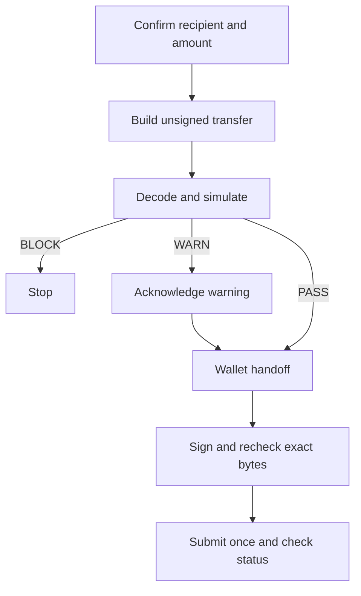
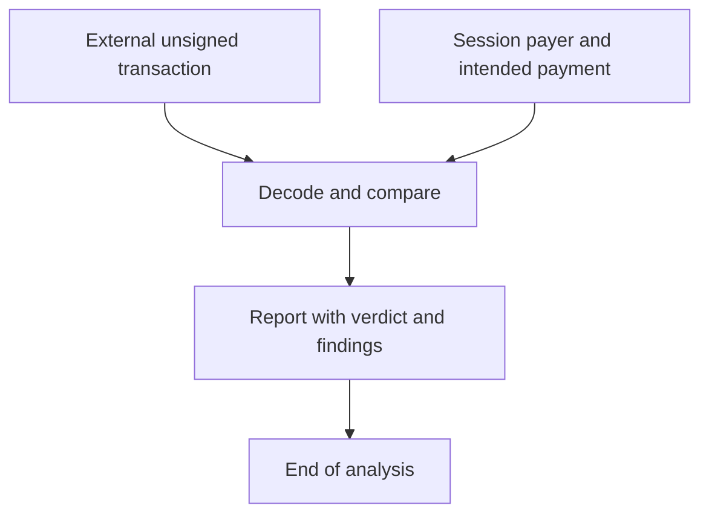
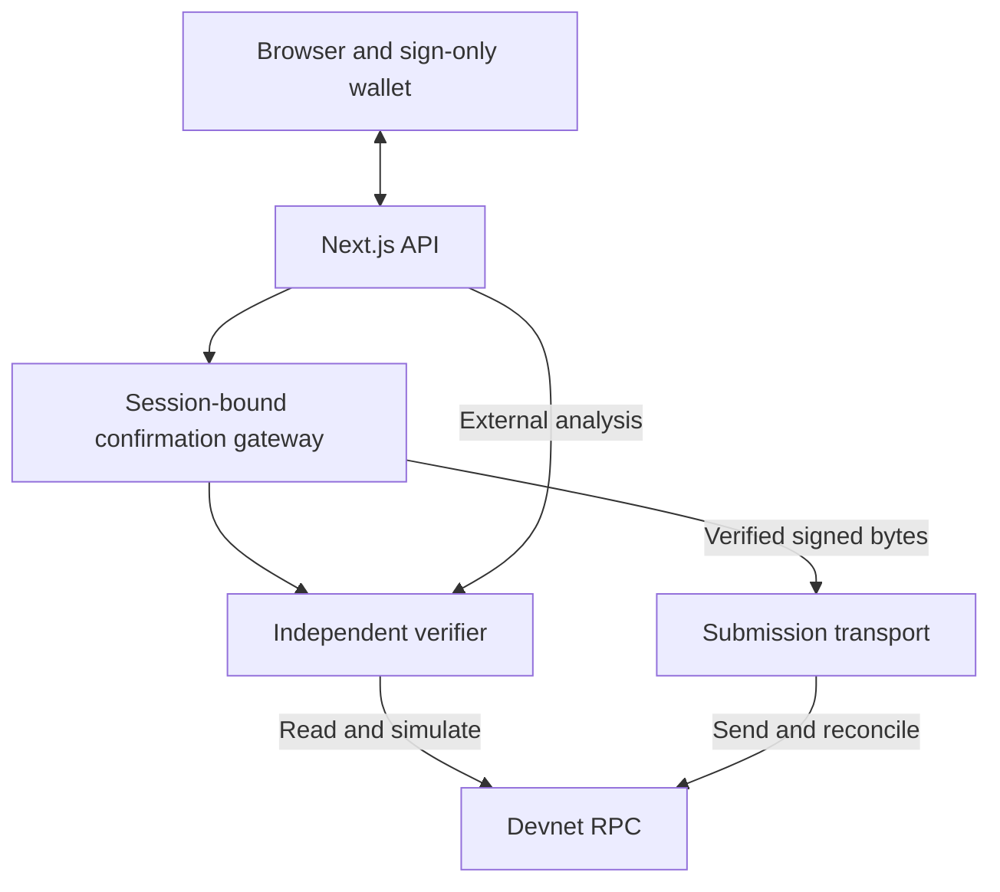

# SolGuard

**Trust nothing. Sign with confidence.**

A transaction can execute successfully and still pay the wrong person. SolGuard checks a Solana Devnet transfer against the recipient and amount you confirmed **before** it reaches your wallet. You can also inspect an unsigned transaction from another app without signing it.

**Live demo (Devnet only):** https://solguard-zettabyte.onrender.com

It needs a wallet set to Devnet with test SOL. The free host sleeps when idle, so the first visit can take a minute. No AI model is attached there: type requests as `send 0.01 SOL to <address>`.

[Workflows](#two-workflows) · [Quick start](#quick-start) · [Demo cases](#reproducible-demonstrations) · [Architecture](#architecture) · [Evidence](#engineering-evidence) · [Documentation](#documentation)

## Why intent verification matters

A user asks to send 0.5 SOL. A malicious or compromised builder can produce an executable transaction with the requested transfer **and** a second transfer to an attacker. The runtime can accept both instructions; execution validity does not prove that the user approved both.

SolGuard compares three different things:

| Evidence | Question |
|---|---|
| Confirmed intent | What did the user explicitly approve? |
| Decoded instructions | What does this exact transaction ask Solana to execute? |
| Devnet simulation | What effects did the RPC report for this message at the observed slot? |

Simulation is not intent verification: it estimates execution against observed state. SolGuard separately decodes and compares the instruction set and simulated balance changes with the confirmed recipient, amount, payer, fee and spending policy. The parser is treated as untrusted input, not as an authority.

## Two workflows

### Intent-based transfer



### External transaction analysis

In **Check a transaction from another app**, try the hidden-transfer or swapped-recipient example. An authenticated user provides an unsigned legacy transaction plus an independently specified recipient and canonical base-unit amount. The API decodes and verifies it against that intent and returns a report. The payer comes from the authenticated wallet session, not the request.

Analysis is **informational**. It does not confirm an intent, acknowledge a warning, create a wallet handoff, sign, or submit. See the [analyzer API contract](docs/wiki/API-Reference.md#post-apianalyze).



## Verdicts

| Verdict | Meaning |
|---|---|
| **PASS** | Required checks succeeded for the inspected transaction and confirmed intent at the observed simulation state. This is not a guarantee of later execution. |
| **WARN** | A recognized condition (currently a zero-balance/new recipient account) requires explicit acknowledgement before transfer handoff. |
| **BLOCK** | Verification failed, required evidence is missing/inconsistent, or an unsupported instruction was encountered. The transfer flow does not offer signing for it. |

Current decoder support is intentionally narrow: canonical legacy System Program transfers and optional bounded compute-budget settings. Other programs and instruction families fail closed. Shared contract rule IDs include reserved token-specific rules that are **not implemented detectors**.

## Quick start

### Requirements

- Node.js 24 and pnpm 12.23.0 (the verified CI versions; the root manifest requires Node.js >=20).
- Git and access to the public Solana Devnet RPC for live demos.

### Install and run locally

The repository’s GitHub default branch may be `readme-only`; explicitly check out the integrated `main` branch:

```sh
git clone https://github.com/layhadarries/Dev3Proj.git
cd Dev3Proj
git switch main
pnpm install --frozen-lockfile
pnpm build
pnpm --filter @solguard/web dev
```

Open `http://localhost:3000`. Development infers the request origin; if using another origin, set `APP_ORIGIN` to that exact origin. Production requires `APP_ORIGIN` to be the canonical HTTPS origin. The app is Devnet-pinned and does not require wallet credentials just to start.

Try `send 0.01 SOL to <recipient>` with a disposable Devnet wallet and a valid test recipient. The simple command needs no model. See [configuration](docs/wiki/Configuration.md) for the optional server-side model settings.

Run workspace checks from the repository root (`Dev3Proj/`), in a second terminal if the app is running:

```sh
pnpm build
pnpm typecheck
pnpm lint
pnpm test
pnpm audit --audit-level high
node --test scripts/verify-https.test.mjs
```

The browser application can initiate Devnet transactions only after wallet interaction. Do not connect a funded wallet or approve a transaction unless intentionally performing an authorized test with disposable Devnet funds.

## Reproducible demonstrations

From the repository root after building, try a matching transfer or run the entire read-only Devnet suite. Both use public RPC reads; neither loads a private key, signs, or submits.

```sh
node packages/security/scripts/demo.mjs match
node --test packages/security/tests/integration/devnet.mjs
```

| Scenario argument | What changes | Verdict | First finding |
|---|---|---|---|
| `match` | Transfer matches the intent | PASS | None |
| `extra` | A second transfer is added | BLOCK | `EXTRA_TRANSFER` |
| `recipient` | Destination differs | BLOCK | `RECIPIENT_MISMATCH` |
| `amount` | Lamports differ | BLOCK | `AMOUNT_MISMATCH` |
| `tamper` | Message bytes change after inspection | BLOCK | `TX_MODIFIED` |
| `unsupported` | An unsupported System instruction is added | BLOCK | `UNSUPPORTED_INSTRUCTION` |
| `warn` | Recipient is a newly generated public address | WARN | `RECIPIENT_NEW_ACCOUNT` |
| `fee` | Excessive priority fee is requested | BLOCK | `EXCESSIVE_PRIORITY_FEE` |

`main` now runs all eight cases once. In `tamper`, the original message passes simulation; the changed bytes fail the subsequent integrity check. Other cases can block before simulation.

The expanded suite was verified locally in [PR #15](https://github.com/layhadarries/Dev3Proj/pull/15) before it was merged into `main`: **8/8 read-only Devnet cases passed**.

## Architecture



The AI parser never connects to the wallet or submission transport. The agent package proposes/builds; the server gateway and independent engine control the authorization boundary. Shared schemas validate data but do not themselves grant authority.

### Repository map

```text
apps/web/                 Next.js interface, API routes, sessions and transport
packages/agent/            Natural-language parser, deterministic builder, explanations
packages/security/         Independent decoder, Devnet verification, gateway and tests
packages/shared/           Runtime schemas and wire serialization
docs/                      Technical, security, demo and verification documentation
docs/wiki/                 GitHub Wiki Markdown export
scripts/                    Local model helper and HTTPS verifier
.github/workflows/          Build/test, audit, secret scan and Devnet CI
```

`packages/security` does not depend on the agent or web application; its workspace boundary allows deterministic testing independently of the UI and parser.

## Security model

- **Authorization is explicit and server-owned.** A browser session binds the wallet and Devnet identity. Confirmation records are bound to that session and move through draft, confirmed, checking, verified, preparing and handed phases. State is consumed before asynchronous work where needed to prevent replay/concurrent reuse.
- **Expiry uses two clocks.** Draft and post-confirmation windows are checked against wall-clock expiry and a monotonic deadline. Confirmation prepares and validates the new intent, timestamps and expiries before atomically committing the state transition.
- **The transaction is treated as hostile bytes.** The engine accepts canonical legacy messages only, requires one payer signer, rejects unsupported/extra instructions and compares exact payer, recipient and lamport amount.
- **Fees and spending are server policy.** Estimated total fee and priority fee are checked before simulation; the configured spending cap compares transfer amount plus fee. Its default is 1 SOL, configured with `SOLGUARD_MAX_SPEND_LAMPORTS`. This is server-side application policy, **not an on-chain limit**.
- **Simulation is independent evidence.** The Devnet RPC is pinned and cluster identity checked. Fee, simulation, balance vectors and blockhash freshness are validated. A compromised or unavailable RPC remains a trust/availability risk.
- **Approval binds exact bytes.** SHA-256 identifies the inspected message. The signed wire must contain that exact message and a valid Ed25519 payer signature. The server uses a private snapshot and single-use handoff; concurrent or replayed submissions fail closed.
- **Submission is controlled and conservative.** The write transport has an application deadline and aborts its HTTP request on timeout, sends at most once, derives the expected signature from the verified signed bytes and reconciles status. Aborting cannot prove the RPC provider did not receive or accept the transaction. Unknown outcomes are surfaced as uncertain; no automatic rebroadcast occurs.

These controls reduce specific risks; they do not guarantee safety or replace independent security review.

## Technology stack

| Layer | Technologies | Role |
|---|---|---|
| Runtime · web | Next.js 15, React 19, Node.js | Browser interface, same-origin API and server-held approvals |
| Runtime · transactions | Solana Web3.js 1.x, Zod 4 | Build and decode legacy messages; validate intent and report contracts |
| Development | TypeScript 5, pnpm workspaces | Compile and type-check the app and the agent, security and shared packages |
| Testing | Vitest 4, Playwright, Node.js test runner | Fixture and route tests, mock-wallet Chromium regression, read-only Devnet harness |
| CI and review | [GitHub Actions](.github/workflows/security.yml), [CodeRabbit](.coderabbit.yaml) | Automated checks and pull-request review |

## Engineering evidence

| Evidence | Result | Source |
|---|---|---|
| Earlier main CI | Before the expanded demonstration suite, run `46151035003` passed checks, secret scan and Devnet job at main `3c1bfec` | [GitHub Actions](https://github.com/layhadarries/Dev3Proj/actions/runs/46151035003) |
| PR #15 evidence (merged into main) | 118 security + 99 agent + 170 web = **387 workspace tests**; 8/8 read-only live Devnet cases; HTTPS synthetic tests 4/4 | [PR #15](https://github.com/layhadarries/Dev3Proj/pull/15), [pinned report](https://github.com/layhadarries/Dev3Proj/blob/d88d96e1706f0510aab3265a11c3a7f77e6b43ee/docs/SECURITY_TEST_REPORT.md#final-security-demonstration--2026-11-29) |
| PR #15 pre-merge CI | Build, typecheck, lint, workspace tests, mock-wallet browser regression, high-severity audit gate and secret scanning passed on the final PR head; PR Devnet job skipped | [Run `46153131293`](https://github.com/layhadarries/Dev3Proj/actions/runs/46153131293) |
| Dependency audit | High-severity gate passes; four moderate transitive advisories remain | [Advisory assessment](docs/wiki/Verification.md#dependency-advisory-assessment-t-04-28-november-2026) |

These GitHub results are a dated snapshot from the audit, not a claim about the documentation PR's checks or current live repository status. The 387 is the workspace test total only; it does not add live demos, browser scenarios, contract probes or duplicate regression invocations. The expanded suite was merged at `ad404f5`; post-merge CI is separate from the recorded pre-merge evidence. Teammate-reported live wallet submissions and browser results are labelled separately in the security report. Real wallet-extension and deployed-HTTPS checks remain separate and are not claimed here.

## Supported scope and limitations

- Devnet only; one legacy SOL System Program transfer, one payer signer, and supported compute-budget settings.
- SPL, Token-2022, versioned transactions/address lookup tables, arbitrary programs, swaps and Mainnet are unsupported. Unsupported instructions fail closed.
- Simulation observes a point in time; state, fees and transaction landing conditions can change.
- The public RPC is a trust and availability dependency. RPC success is evidence, not a cryptographic guarantee of all network state.
- Session, confirmation, challenge, rate-limit and in-flight state are process-local; restart invalidates state and multiple workers do not share quotas.
- An ambiguous broadcast may have reached the provider. SolGuard reconciles by expected signature and does not automatically rebroadcast, but cannot promise provider-side cancellation.
- Protection applies only to transactions routed through SolGuard; it cannot constrain other wallet activity.
- The server spending cap is not enforced by the Solana program/on-chain.
- Four moderate transitive dependency advisories remain. The high-severity audit gate passes; this is not a clean audit or a certification.
- SolGuard has not been independently audited. No safety guarantee is claimed.

### Roadmap

Possible future work, not current functionality: SPL/Token-2022 support, additional transaction formats, shared/distributed session storage, broader wallet compatibility, and Mainnet support after a separate threat and policy review.

## Team

SolGuard is built by **Zettabyte**. The repository attributes workstreams as follows:

| Contributor | Responsibilities |
|---|---|
| [Ethan Le Roux (Megaguy32)](https://github.com/Megaguy32) | Agent/parser, natural-language interpretation, transaction construction and agent tests |
| [Taz (Tazio)](https://github.com/Tazio0) | Security engine, backend, deterministic verification, sessions, transaction integrity and adversarial testing |
| [Zulayha](https://github.com/layhadarries) | Frontend, wallet experience, visual design, presentation and demo |

## Built before and during the hackathon

> **Why this section is here:** the [hackathon rules](https://hack.dev3pack.xyz/faq) say that pre-existing code from your own Solana projects is allowed, and ask teams to "be transparent in the README about what was built before vs. during."

The hackathon runs 27-29 November 2026.

- **Before (26 November):** the first README, the project scaffold, a first version of the shared data contracts and security checks, and a first version of the request parser and transaction builder with a script for a local open-weight model.
- **During (27-29 November):** the Devnet security engine and confirmation step, the adaptation and hardening of the parser and builder, the web app and server, wallet signing, Devnet submission, further tests, CI and documentation.

AI coding assistants were used. The commit history shows the dates.

## Documentation

| Area | Guides |
|---|---|
| Getting started | [Install and run](docs/wiki/Installation.md), [quick start](docs/wiki/Quick-Start.md), [configuration](docs/wiki/Configuration.md), [demo](docs/DEMO.md) |
| Architecture and integration | [System architecture](docs/wiki/Architecture.md), [security architecture](docs/SECURITY_ARCHITECTURE.md), [Solana integration](docs/SOLANA_INTEGRATION.md), [agent integration](docs/AGENT.md), [API reference](docs/wiki/API-Reference.md) |
| Security and threat model | [Threat model](docs/wiki/Threat-Model.md), [transaction firewall](docs/wiki/Transaction-Firewall.md), [authentication](docs/wiki/Authentication.md), [AI security](docs/wiki/AI-Security.md), [security review history](docs/SECURITY_REVIEW.md) |
| Testing and verification | [Security test report](docs/SECURITY_TEST_REPORT.md), [verification wiki](docs/wiki/Verification.md), [testing guide](docs/wiki/Testing.md), [penetration-testing methodology](docs/wiki/Penetration-Testing.md) |
| Deployment and operations | [Deployment notes](docs/wiki/Deployment.md), [browser security](docs/wiki/Browser-Security.md), [rate limits](docs/wiki/Rate-Limits.md), [troubleshooting](docs/wiki/Troubleshooting.md) |
| Known limitations | [Limitations and roadmap](docs/wiki/Limitations.md) |

## Contributing

SolGuard handles security-sensitive transaction data. Keep contributions focused; preserve fail-closed behavior; add regression tests for security-relevant changes; document what was tested and what was not. Do not include private keys, seed phrases, credential-bearing RPC URLs, private audit artifacts or personal wallet evidence in issues, commits or CI logs. Coordinate changes to shared wire contracts with the team.

## License

No license file or approved license decision is present in the repository. Reuse and redistribution terms remain for the team to decide; no license is implied here.
