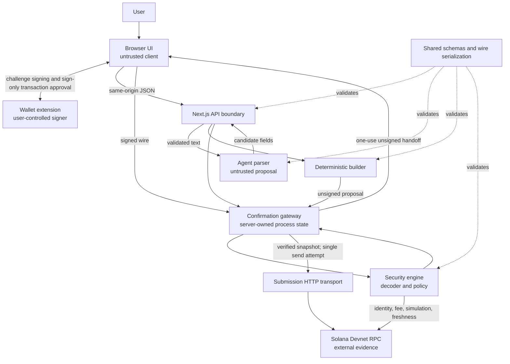

# SolGuard security architecture

SolGuard is a Devnet-only, server-mediated transaction firewall for one legacy SOL transfer and one payer signature. This document describes the integrated implementation, not a proposed architecture. The system reduces risk for transactions routed through its transfer flow; it does not guarantee safety or constrain unrelated wallet activity.

## Components and trust boundaries

**Authorization boundary:** AI output, browser state, reports supplied to presentation routes, and third-party transaction bytes are not authorization. The server-side session establishes wallet/network identity; `confirm` transitions a server-held draft into confirmed intent; only the independent verifier can approve the exact message; and the wallet owner performs the signature. A WARN requires a separate acknowledgement before handoff. Shared schemas validate structure but do not grant authority.

The wallet extension is outside the server trust boundary: it can display differently, refuse signing, or alter bytes. SolGuard verifies the returned signed bytes before submission. A user can also use the wallet outside SolGuard; those transactions are outside this service’s protection.

## Transfer state and authorization

The process-local confirmation gateway is the authority for records bound to session ID, wallet public key and `devnet` network. Its flow is:

```mermaid
stateDiagram-v2
    [*] --> Draft
    Draft --> Confirmed: explicit user action; atomic intent/expiry update
    Confirmed --> Checking: inspect begins
    Checking --> Verified: PASS or WARN with verified report
    Checking --> [*]: BLOCK, failure or session change
    Verified --> Verified: explicit WARN acknowledgement only
    Verified --> Preparing: handoff begins
    Preparing --> Handed: exact message refreshed; WARN acknowledged
    Preparing --> [*]: failure, expiry or changed session
    Handed --> [*]: consume once before async signed verification
```

- Draft creation uses a random UUID, validated Base58 recipient, positive canonical u64 decimal lamports, and server-resolved session. The 60-second draft window starts on stage.
- `confirm` requires the draft phase and valid wall/monotonic clocks. It computes and validates the confirmed intent copy, positive timestamp, expiry and new monotonic deadline before committing any state. The confirmed action starts a fresh 60-second verification window.
- Wall time gives the persisted/displayed expiry; `performance.now()` enforces elapsed-time expiry independent of wall-clock adjustments. Expiry, identity or phase mismatch fails closed.
- `inspect` reserves the `checking` phase synchronously before RPC awaits. It checks canonical built-message encoding, intent ID, SHA-256 message hash and recent blockhash binding. It then invokes the independent verifier and rechecks the authenticated session after the asynchronous work.
- WARN acknowledgement is a separate session-bound server action. Handoff requires the stored report to be non-BLOCK and, for WARN, the explicit acknowledgement flag.
- The handoff is one-use. Submission removes the record before awaiting signed-byte verification/transport, so concurrent reuse and failed attempts cannot resurrect it.

These gates establish application-level authorization for requests routed through the server. They cannot force a user gesture in a compromised browser or prohibit wallet activity elsewhere.

## Deterministic transaction verification

The verifier is independent of `packages/agent` and `apps/web`. It accepts canonical serialized legacy messages only (message bytes are bounded to 1167; the full transaction wire is bounded to 1232), with exactly one writable payer signature requirement. It rejects versioned messages, duplicate/unused account keys, unknown programs and unsupported instruction variants. Supported instructions are one System Program SOL transfer and optional unique, valid compute-unit limit/price settings.

For a confirmed intent, it:

1. Validates SOL intent, payer, network, policy limits and exact transfer payer/recipient/lamports. Application route behavior also rejects a self-transfer.
2. Obtains the Devnet cluster identity, estimated fee, bounded simulation evidence and exact blockhash freshness.
3. Enforces total estimated fee and priority-fee limits; the server spend cap checks `transfer lamports + fee` before simulation.
4. Checks simulation slot ordering, fee consistency, balance-vector width, account evidence and expected balance deltas. Unexpected changes block.
5. Emits WARN when the recipient had zero lamports at the simulated pre-state; otherwise it can emit PASS, provided all checks succeeded.

Simulation predicts effects for the observed bank state; it does not establish intent by itself and cannot guarantee later execution. State can change before landing, and the RPC provider is trusted to report evidence accurately. Unavailable, malformed or inconsistent evidence blocks.

The default application spend ceiling is 1 SOL total debit including fees. `SOLGUARD_MAX_SPEND_LAMPORTS` configures this server-side cap as canonical decimal u64. It is **not on-chain enforcement**.

## Exact message and signed-wire integrity

The builder emits a deterministic unsigned legacy transaction from the confirmed server intent. The system records SHA-256 of the exact inspected message bytes. The verifier’s local approval record binds report identity to the intent, wallet, network, policy, recent blockhash, RPC client and monotonic start time; a copied/forged JSON report is not a capability.

At handoff the message, policy, intent, timing and fee/freshness evidence are rechecked. After wallet signing, the server snapshots the submitted bytes and verifies:

- Exactly one signature slot and bounded legacy wire shape.
- The exact previously inspected message bytes/hash.
- A canonical valid Ed25519 signature from the intent payer.
- Unchanged session, wallet, network, policy, fee and blockhash freshness.

Mutation, missing/invalid signatures, expiry or reuse blocks and consumes the approval. The server does not submit wallet-modified bytes.

## Submission and ambiguous outcomes

The submission transport is separate from read/status RPC. Each write gets its own `AbortController`; the transport sets the application deadline, disables SDK rate-limit retries, sets validator forwarding `maxRetries: 0`, and aborts the local HTTP request when its deadline expires. This is application-controlled cancellation only: an abort does **not** prove the provider never received or accepted the transaction.

Before broadcast, the expected signature is derived from the exact verified signed bytes. SolGuard performs no automatic resend. If send throws or times out, it polls status by that expected signature and only treats coherent confirmed/finalized success as success. A returned signature must match the expected one. Terminal confirmed/finalized failure is reported as failure; missing, processed, malformed, contradictory or unavailable evidence remains unknown until the bounded confirmation timeout. An uncertain response tells the client not to submit again and to reconcile the signature.

This prevents this service from intentionally issuing a second broadcast after uncertainty. It cannot determine every provider-side outcome or cancel work already accepted by remote infrastructure.

## Browser/API boundary

The API requires POST, JSON, exact `Origin`, and rejects non-same-origin Fetch Metadata. Streamed request bodies are capped at 32 KiB with a 10-second read deadline. Errors are sanitized and non-cacheable. Forwarded IP headers are ignored because the request boundary has no verified peer address. Fixed-window rate buckets, confirmation records, sessions, challenges and in-flight reservations are bounded but process-local.

Wallet sign-in uses an origin/wallet/network-bound Ed25519 challenge, short-lived HttpOnly/SameSite=Strict pre-auth context, and opaque one-hour session cookie (`Secure` and `__Host-` naming in production). Success consumes the challenge/context and rotates previous same-wallet sessions. These stores do not provide distributed revocation across multiple processes.

The LLM receives text only, no tools, RPC, secrets or wallet access. Its output is strictly parsed and grounded against values in user text. The deterministic builder and security engine do not trust model prose, explanations or report claims as approval.

## Current rule catalogue versus reserved contracts

The shared `RuleId` schema contains IDs for future token analysis and other capabilities. They are wire-contract vocabulary, not evidence that a detector exists. Current verifier/decoder emissions include applicable cases among: `AMOUNT_MISMATCH`, `RECIPIENT_MISMATCH`, `PAYER_MISMATCH`, `ASSET_MISMATCH`, `EXTRA_TRANSFER`, `UNEXPECTED_BALANCE_CHANGE`, `UNKNOWN_PROGRAM`, `UNSUPPORTED_INSTRUCTION`, `UNDECODABLE_MESSAGE`, `EXTRA_SIGNER`, `EXCESSIVE_PRIORITY_FEE`, `SIM_FAILED`, `RPC_UNAVAILABLE`, `RPC_INCONSISTENT`, `TX_EXPIRED`, `TX_MODIFIED`, `INTERNAL_ERROR`, and `RECIPIENT_NEW_ACCOUNT`. Detection is conditional on the failure path.

`UNAUTHORIZED_APPROVAL`, `AUTHORITY_CHANGE`, `ACCOUNT_CLOSE`, `LOOKUP_TABLE_UNRESOLVED`, `DURABLE_NONCE_USED`, `TOKEN_FREEZE_AUTH`, `TOKEN_PERMANENT_DELEGATE`, `TOKEN_TRANSFER_FEE`, `TOKEN_OTHER_EXTENSION`, `ACCOUNT_CREATED` and `FEE_BREAKDOWN` are reserved/shared-contract IDs and are not current token-specific detection capabilities. Some other catalogue entries, such as `EXTRA_TRANSFER` and `RECIPIENT_NEW_ACCOUNT`, are emitted by parser/demo fixtures or particular paths; that does not mean the implementation has general-purpose support for every transfer/program family.

## Residual risks and scope

- Devnet only; legacy single-signer SOL transfer only.
- No SPL/Token-2022, arbitrary programs, versioned transactions, lookup-table resolution, swaps, Anchor vault or Mainnet.
- Public RPC trust, availability, bank-state freshness and network behavior.
- Process-local state is lost on restart and is not shared across instances.
- Browser compromise and transactions outside SolGuard are not prevented.
- Simulation and application spending caps are not on-chain guarantees.
- Abort cannot establish provider non-acceptance; uncertain sends require reconciliation.
- Four moderate transitive dependency advisories remain; high-severity audit gate passes. The audit is not clean or a certification.
- No independent security audit or safety guarantee is claimed.

See [threat model](wiki/Threat-Model.md), [API reference](wiki/API-Reference.md), [security report](SECURITY_TEST_REPORT.md), and [limitations](wiki/Limitations.md).
