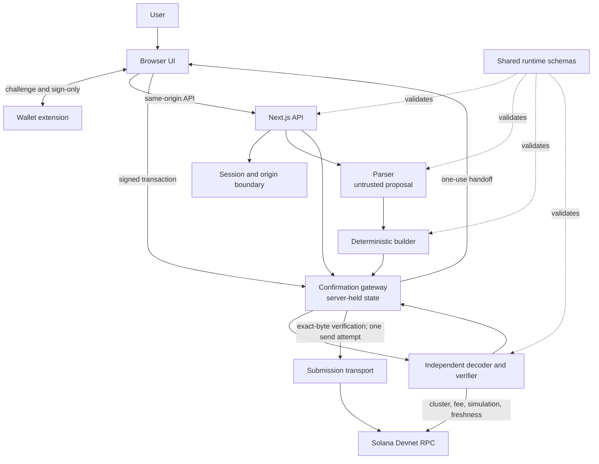

# System architecture

## Components

- **Frontend:** Next.js UI, wallet connection, explicit confirmation and warning review.
- **Web API:** strict JSON handlers, Origin/Fetch Metadata checks, session resolution, fixed-window rate and in-flight limits, and server composition.
- **Agent:** proposes parsed transfer fields and builds unsigned transactions. Its output cannot authorize signing.
- **Shared contracts:** runtime schemas and wire serialization for intents, transactions and reports; schemas validate structure but do not grant authority.
- **Security engine:** independent legacy transaction decoder, fee/spending policy, Devnet simulation, freshness and signed-byte integrity checks.
- **Confirmation gateway:** process-local, one-time state bound to session, wallet, network, intent and approval phases.
- **Wallet:** signs the authentication challenge and approved transaction; the application uses sign-only, not sign-and-send.
- **RPC:** pinned public Solana Devnet endpoint for identity, reads, simulation, broadcast and status reconciliation.

An authenticated `POST /api/analyze` endpoint can inspect a caller-supplied unsigned transaction against the session wallet and supplied intent. It returns an informational report and is separate from the confirmation/handoff/submission path.

## Trust boundaries

User text, model output, HTTP bodies, browser state, wallet-returned bytes and RPC responses are treated as untrusted inputs. The server owns authenticated identity, confirmation state and policy. The RPC operator remains trusted for evidence accuracy and availability. The wallet is user-controlled; SolGuard verifies the returned transaction bytes before submission but cannot constrain activity outside its own flow.

See [security architecture](../SECURITY_ARCHITECTURE.md) for state transitions, transaction policy and residual risk.
