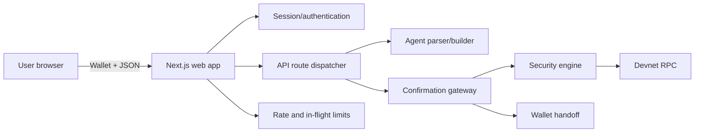
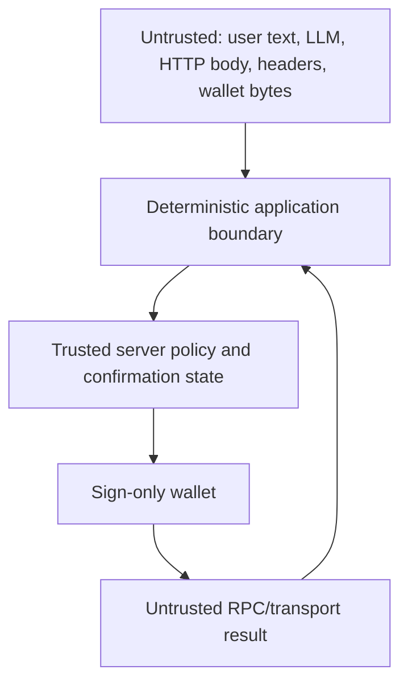

# System architecture

## Components

- **Frontend**: Next.js UI, wallet adapter, confirmation and warning review.
- **Web API**: strict JSON handlers, Origin/Fetch Metadata checks, session
  resolution, rate limits and transport composition.
- **Agent**: natural-language parsing and unsigned transaction construction.
- **Shared contracts**: Zod schemas and wire serialization for intent,
  transaction and security reports.
- **Security engine**: deterministic decode, simulation, policy and integrity
  checks.
- **Confirmation gateway**: process-local, one-time server state binding
  wallet, network, intent and approval phases.
- **Wallet**: client-side Ed25519 login and sign-only transaction approval.
- **RPC**: pinned public Devnet endpoint for reads, simulation and broadcast.

## Trust boundaries

The browser, AI, network, RPC and transaction bytes are untrusted by default.
The Node server owns confirmation state and policy. The RPC operator is trusted
for evidence accuracy but can still cause unknown or stale results.
