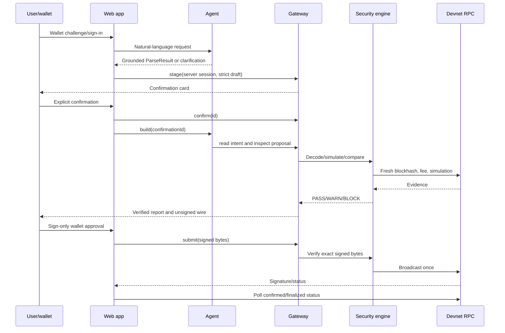

# Transaction lifecycle

## Stop conditions

- Invalid, oversized or ambiguous HTTP input
- Missing/expired/revoked wallet session
- Draft or confirmation mismatch
- BLOCK verdict
- Missing warning acknowledgement for WARN
- Wallet or network change
- Stale blockhash or expiry
- Signed-message modification
- Broadcast deadline or RPC reconciliation failure
- Duplicate or concurrent submission

The transaction approval record is consumed at a phase transition or replay;
uncertain outcomes require reconciliation and never trigger automatic resubmit.
